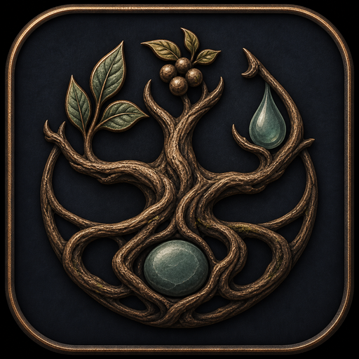

  

# Black Spirit Life

A free Windows app for Black Desert life skills. Plan what to craft, see what you
need, and find where to get it.

[**Download the installer**](https://github.com/Sanitee/black-spirit-life/releases/latest/download/BlackSpiritLifeInstaller.exe)
· [What's new](https://github.com/Sanitee/black-spirit-life/releases/latest)

## Features

- **Crafting:** recipes, substitutes, inventory, market stock and profit estimates.
- **Resource Map:** gathering spots, vendors, worker nodes, housing and storage.
- **Opportunities:** compare crafting and exchanges.
- **Gathering and Fishing:** maps, tools, profiles and your saved runs or catches.
- **Imports:** add inventory from screenshots or review Gathering session imports.

## Install and update

Requires **64-bit Windows 10 or 11**.

1. Download and run **BlackSpiritLifeInstaller.exe**.
2. Choose an install folder and finish setup.

Already installed? Use the update button inside the app. Updates keep your saves.

Windows may show an unknown-publisher warning because the app is not signed yet.
Use the installer above; GitHub's “Source code” downloads are not the app.

The optional **Session Import** window also needs **Microsoft .NET 8 Desktop
Runtime (x64)**, installed separately.

## Your saves

Your saves stay on your PC, separate from the app. To see or change their folder,
open **Craft Planner → Craft Profile**. A new installation starts empty unless
an existing save is found. No creator's saves or accounts are included.

## Help and credits

[Report a problem](https://github.com/Sanitee/black-spirit-life/issues)
· [Technical docs](docs/)
· [Asset credits](ASSET_SOURCES.md)
· [Third-party notices](THIRD_PARTY_NOTICES.md)

Black Desert and its game content belong to Pearl Abyss.

> This is unofficial content which contains copyrighted materials and IP from
> Pearl Abyss, and is not official/endorsed content.

Black Spirit Life is free and noncommercial. The [license](LICENSE) covers the
original app code only.
