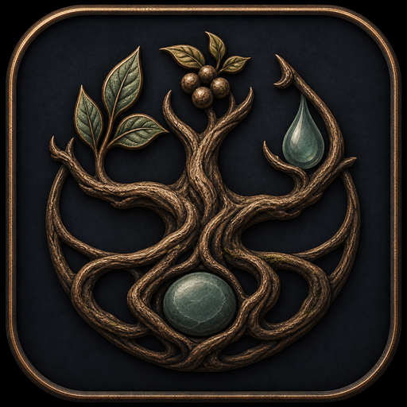

  

# Black Spirit Life

Black Spirit Life is a free Windows app I made to take some of the busywork out
of life skilling in Black Desert. Pick what you want to make and it works
backwards through the recipe chain, showing what to craft and what you still
need to get.

The planner and resource map live in the same app, so you can jump from a
missing material to gathering spots, worker nodes, or NPC vendors when those
options are available.

[**Download the latest installer**](https://github.com/Sanitee/black-spirit-life/releases/latest/download/BlackSpiritLifeInstaller.exe)
· [Release notes](https://github.com/Sanitee/black-spirit-life/releases/latest)

## What it can do

- Plan Cooking, Alchemy, and Processing using your inventory, mastery, recipe
  variants, and expected output.
- Break large crafting chains into a saved **Craft Queue** and **Need First**
  list.
- Search the Recipe Book by recipe or ingredient and review materials,
  alternatives, effects, and item uses.
- Add items manually or import an inventory screenshot through a local,
  review-first recognition flow.
- Find gathering spots, worker nodes, and NPC vendors on the built-in map.
- Turn missing materials into a checklist or a CP-aware worker-node plan, then
  compare lodging and storage-house investments.
- Review market-aware crafting and exchange opportunities without placing
  orders or sending personal planner data to a third party.
- Prepare Gathering runs with the complete map, field guide, loot, market,
  Bairog/BDO Workshop reference tools, loadouts, and local session history.
- Use Fish Map, haul entry, journal, statistics, screenshot recognition, and
  Fishing/Harpooning profiles without a Black Spirit Life account or cloud
  sync.
- Import and review Gathering activity locally, including the optional
  app-managed Garmoth workflow.
- Keep your favorites, progress, profile settings, and appearance choices
  between app sessions.

## Install

Black Spirit Life requires 64-bit Windows 10 or 11.

The optional **Session Import** window requires the Microsoft .NET 8 Desktop
Runtime for x64. That runtime is installed separately and is not bundled with
Black Spirit Life.

1. Download `BlackSpiritLifeInstaller.exe` from the link above.
2. Run it and choose where to install the app.
3. Complete the short first-time setup.

The app is not code-signed yet, so Windows may show an unknown-publisher or
SmartScreen warning. Only use the installer from the official release page;
GitHub's automatic “Source code” downloads are not the installer.

Once installed, future updates can be downloaded and installed from the update
bar inside the app without opening a browser.

## Your data

Your inventory, mastery, Fairy and weight settings, market bonuses, family
fame, plans, favorites, checklist, Gathering loadouts and sessions, Fishing
profiles and journal, Session Import drafts/history, Garmoth connection and
browser state, Opportunities preferences, and app settings are kept locally
in one selected personal-data folder, separate from the application. The
current folder is visible from the app title bar; open **Craft Planner > Craft
Profile** to review or change it. Normal updates keep that folder in place.

On first launch, the app loads an existing Stable profile only when one is
already present in the selected local personal-data folder. With no saved
profile, it starts empty. It does not automatically copy data from Beta, an
older planner, or another person.

When an existing Stable 0.1.7 profile is present in that selected folder,
0.1.9 migrates its supported Gathering and Fishing records locally. The
original records and recovery information stay on the same PC; nothing is
uploaded as part of migration.

The installer contains immutable app/reference data, including the credited
Fishing and Gathering reference libraries. Those files are not a saved user
profile or activity history. The release contains no publisher profile,
mastery values, inventory, loadout, journal, session, credential, cookie,
browser profile, or publisher/player-specific local machine path.

## Credits and help

Black Desert and its game content belong to Pearl Abyss. Community research and
map sources—including BDO Codex, BDOLytics, Workerman/Shrddr,
SomethingLovely, and bdo-empire—are credited in
[Asset Sources](ASSET_SOURCES.md) and
[Third-Party Notices](THIRD_PARTY_NOTICES.md).

> This is unofficial content which contains copyrighted materials and IP from
> Pearl Abyss, and is not official/endorsed content.

Black Spirit Life is free and noncommercial. The root [license](LICENSE)
covers the original app code only.

Found something wrong or need help?
[Open an issue](https://github.com/Sanitee/black-spirit-life/issues).
Technical details are kept in [docs](docs/) and the
[Resource Map guide](docs/resource-map/README.md).
